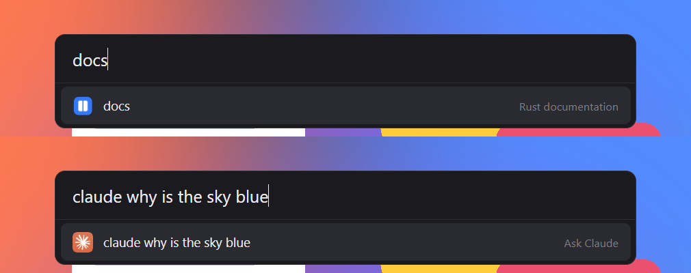
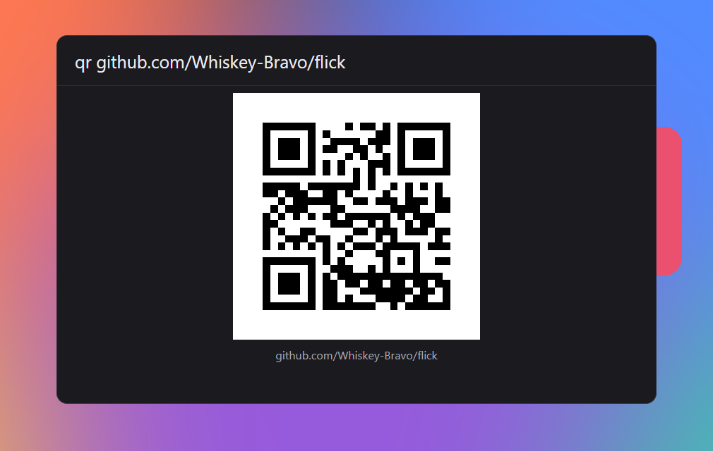
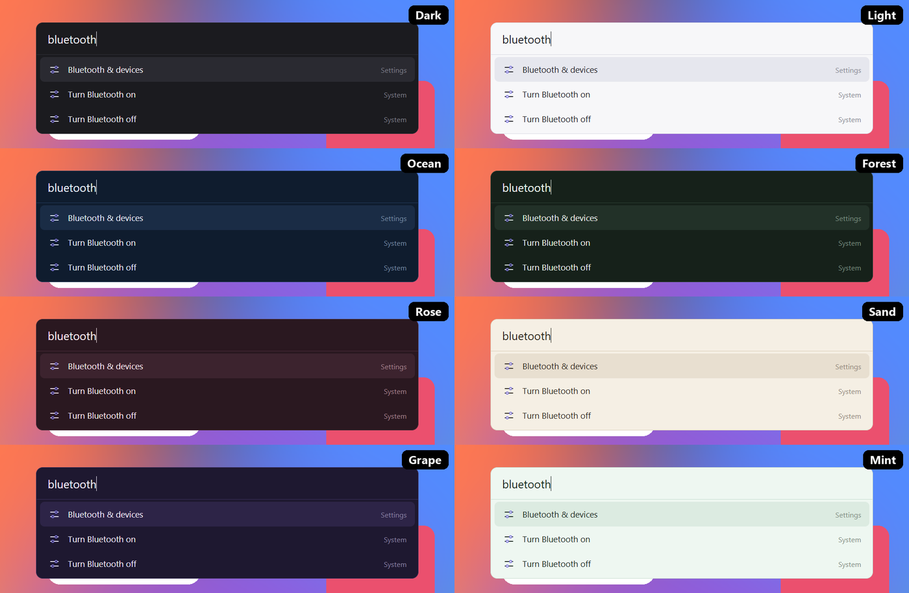
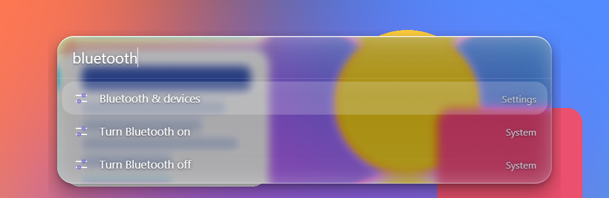
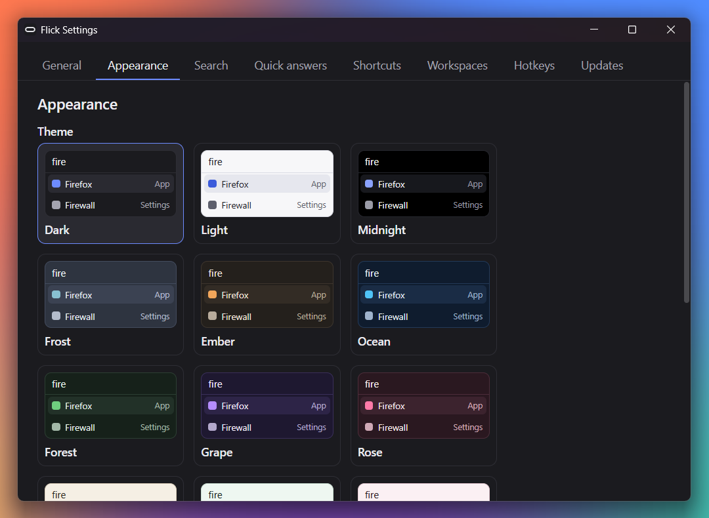

# Flick

A fast keyboard launcher for Windows 11. Press **Alt+Space**, type a few letters, press Enter.

Flick finds your apps, files and settings, answers quick questions, runs your own shortcuts, and stays out of the way until you call it. It is small, starts in an instant, and keeps what you do on your PC.

## Install

1. Download `Flick_<version>_x64-setup.exe` from the [latest release](https://github.com/Whiskey-Bravo/flick/releases/latest).
2. Run it. It installs for the current user and needs no admin rights.
3. The installer is not signed, so Windows may say "Windows protected your PC". Click **More info**, then **Run anyway**.

Flick opens once with a welcome and starts at login from then on. Updates arrive inside the bar. To uninstall, use Windows' Settings, Apps.

## What it can do

### Open anything

Apps, files, folders, Windows Settings pages, games and browser bookmarks, all from the same box. The things you open most rise to the top, and you can pin favourites.

### Answer without leaving the keyboard

Sums, unit and currency conversions, times around the world, dates and the weather. Enter copies the answer.

### Your own shortcuts, with their own icons

A word of your choice opens a site, runs a command or starts a script, and can take what you type after it. `claude why is the sky blue` opens Claude with your question already asked; `g`, `yt` and `gh` search Google, YouTube and GitHub.

### Clipboard, snips and small chores

Type `v` for your clipboard history, `snip` for a screenshot, `color` to pick a colour off the screen, `qr` to turn text into a QR code. Set a `timer 5m`, mute the sound, switch dark mode, connect your headphones, empty the bin.

### Make it yours

Fourteen themes, your own colours, and three levels of animation. **Glass** turns the bar into a pane that shows what is behind it.

### Take over the Win key

Let a tap of the Win key open Flick instead of the Start menu. Win+E, Win+D and every other combination keep working, and Ctrl+Esc still opens Start.

### Everything in one Settings window

No config file needed, though there is one if you prefer it. Hotkeys for single items, workspaces that open several things at once, and all of the above.

## Privacy

- **Nothing you type leaves your PC** unless you ask for something that lives online: a currency rate, the weather, a translation, a definition, your public IP address, or the daily check for a new version.
- **One switch turns all of that off:** `online = false`.
- **What Flick remembers stays in files on your PC:** which results you pick, your last 50 searches and your pins. `history = false` stops the remembering.
- **No account, no telemetry, no ads.**

The [privacy page](docs/privacy.md) lists every file Flick writes and every request it can make.

## Learn more

| | |
|---|---|
| [Typing and keys](docs/typing.md) | Everything you can type, the keys, pins and past searches |
| [Quick answers](docs/answers.md) | Sums, units, currencies, weather, timers, translating |
| [Files, clipboard and capture](docs/files.md) | Files and folders, clipboard history, QR codes, snips |
| [Shortcuts, WSL and workspaces](docs/shortcuts.md) | Your own commands, WSL, workspaces and direct hotkeys |
| [Windows controls](docs/windows.md) | System toggles, devices, the Win key, the taskbar |
| [Settings, appearance and config](docs/settings.md) | The Settings window, themes, updates, the config file |
| [Privacy](docs/privacy.md) | What is kept, what goes online, what never does |
| [Build from source](docs/building.md) | Building Flick yourself |

Inside Flick, type `help` or press F1 for a list of everything it can do.

## License

MIT
