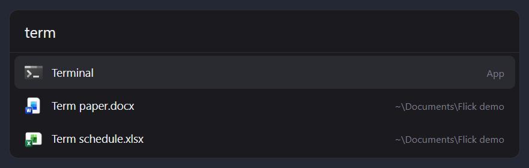
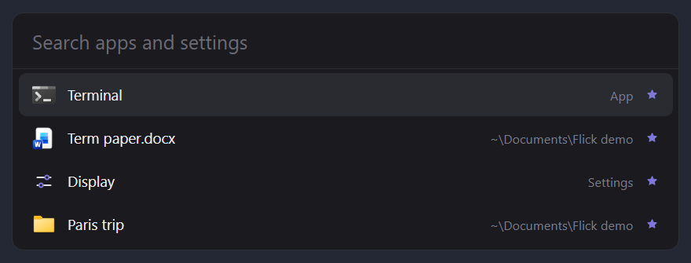

# Flick

A small keyboard launcher for Windows 11. Press Alt+Space (or your own hotkey), type a few letters, press Enter.



Flick finds apps, files, folders and Settings pages, runs power actions, runs commands in WSL, and runs your own shortcuts. Each result has its icon, and you can use the mouse as well as the keyboard. It is built for personal use with Tauri 2 (a Rust core and a plain TypeScript front end).

## Install

1. Download `Flick_<version>_x64-setup.exe` from the Releases page of this repository.
2. Run it. It installs for the current user and needs no admin rights.
3. The installer is not signed, so Windows may say "Windows protected your PC". Click More info, then Run anyway.

Flick starts when the installer finishes and opens the bar once with a welcome. From then on it starts at login; the tray menu item Start at login turns that off.

To uninstall, use Settings, Apps. This also removes start at login.

## What you can type

| You type | What happens | Example |
|---|---|---|
| Part of an app name | Opens the app (Start-menu shortcuts and Store apps) | `vsc` opens Visual Studio Code |
| Part of a file or folder name | Opens it (searches your whole user folder by default) | `invoice` |
| A folder path (a drive, `~`, or a network share) | Lists that folder's contents; Enter opens an item | `C:\`, `~\Documents\` |
| `dl` | The 20 newest files in your Downloads folder | `dl` |
| `recent` | Files and folders you opened recently, from Windows' own Recent list | `recent` |
| `v`, then text to filter | Your clipboard history (Win+V); Enter pastes the item | `v`, `v invoice` |
| `qr`, or `qr` and some text | Shows the clipboard text, or the typed text, as a QR code | `qr`, `qr some text` |
| `snip` (also `screenshot`) | Opens Windows' snip tool | `snip` |
| `color` (also `colour`, `picker`) | Picks a colour on screen and copies it as `#RRGGBB` | `color` |
| A Settings page | Opens that Windows Settings page | `bluetooth`, `installed apps` |
| A power action | Lock, sleep, restart, shut down or sign out | `lock` |
| Part of a game's name | Starts the game through its launcher (Steam, Epic, Rockstar, Minecraft) | `hades` |
| Part of a bookmark's title or site | Opens the Firefox bookmark in your browser | `example` |
| A workspace's name | Opens every item of the workspace, in order | `work` |
| `timer` and a time | A timer that rings with a Windows notification | `timer 5m` |
| `remind`, a time and a note | A reminder after a while, at a time today, or tomorrow | `remind 20m pizza`, `remind 18:30 call mum`, `remind tomorrow 9:00 dentist` |
| `timers` | Your pending timers and reminders; Enter twice cancels one | `timers` |
| `tr` and some text | Translates between German and English (online) | `tr guten Morgen` |
| `def` and a word | Definitions from Wiktionary (online) | `def serendipity` |
| `connect` or `disconnect`, and a device | Connects or disconnects a paired Bluetooth audio device | `connect headphones` |
| `wifi` and a network | Joins a saved Wi-Fi network | `wifi home` |
| `empty bin` | Empties the Recycle Bin (press Enter twice) | `empty bin` |
| `eject`, or `eject` and a drive | Safely removes a USB drive | `eject`, `eject E:` |
| `flush dns` | Clears Windows' DNS cache | `flush dns` |
| `restart explorer` | Restarts the taskbar and desktop (press Enter twice) | `restart explorer` |
| A sum, a unit or currency conversion, a time or date, or `weather` | Shows the answer on top; Enter copies it (on a weather answer, Enter opens a web search) | `12*7`, `20 usd in eur`, `time tokyo` (see Quick answers) |
| `?`, `g`, `yt` or `gh`, then your search | Searches the web in your browser | `? rust lifetimes` |
| The name of one of your shortcuts | Runs it | `search rust traits` (after adding the `search` shortcut shown below) |
| `>` and a command | Runs the command in WSL | `> htop -d 10` |
| `clear history` | Forgets recent searches and launches (press Enter twice) | `clear history` |
| `help`, or press F1 | Lists everything Flick can do | `help file` |
| `settings` | Opens the Settings window | `settings` |
| `flick config` | Opens the config file | `flick config` |

If you press Enter while results for what you just typed are still on their way, Flick waits for them and opens the new top result.

## Keys

| Key | Action |
|---|---|
| Alt+Space | Open the bar (configurable) |
| Enter | Open the selected result |
| Ctrl+Enter | Show the selected file or folder in Explorer |
| Ctrl+Shift+Enter | Run the selected app as administrator |
| Enter again | Confirm restart, shut down or sign out |
| Up / Down | Move the selection |
| Tab | Open the actions menu of the selected row; while a path is typed, complete the selected name |
| Mouse wheel | Scroll the list |
| Up (empty bar) | Recall your past searches, newest first |
| Ctrl+P | Pin or unpin the selected row |
| F1 | Show the help list |
| Esc | Leave a shortcut's list; otherwise close the bar |

On an empty bar, Enter opens the most recent launch again.

The hotkey does nothing while an exclusive full-screen app (such as a game) is in front.

Ctrl+Shift+Enter works for apps only, both Start-menu shortcuts and Store apps. Your own shortcuts with `admin = true` always run as administrator. A Store app that cannot be elevated says "this app cannot be run as administrator" instead of opening normally. Cancelling the UAC prompt just closes the bar.

## Win key

Flick can take over the Win key: tap it on its own and the bar opens instead of the Start menu; tap it again to close the bar. It is off by default. Switch it on in Settings, General (Win key opens Flick), or set `win_key = true` in the config. It applies at once, with no restart.

- Win combinations keep working as before: Win+E, Win+D, Win+V, Win+Shift+S and the rest. Holding Win and clicking or scrolling counts as a combination too, so the bar stays closed.
- The Start menu is still there: press Ctrl+Esc, or type `start` in the bar and pick the Start menu row. The row can't open Start when a window running as administrator was in front (Windows blocks Flick's keys there); Ctrl+Esc typed by hand still works.
- Windows keeps the Win key while a window running as administrator is in front, while an exclusive full-screen game is running, and while Settings is waiting for you to press a hotkey. A tap then opens Start as usual.
- If Windows doesn't let Flick watch the Win key, Settings says "The Win key isn't available right now; Alt+Space still works." (with your bar hotkey). The bar hotkey is not affected by this setting.

## Icons and the mouse

Each result shows the icon of its app, file or folder. Icons load in the background, so the text always appears first.

- Moving the mouse over a row selects it.
- A click opens it.
- A right click (or Tab) opens a menu of the row's own actions: Open file location, Open in Explorer, Copy path, Run as administrator, Uninstall (asks for a second Enter), Close, Close window, Pin or Unpin. Entries that do not apply to that row are left out.

## Pins and recent launches

Pin the things you open every day. Select a row and press Ctrl+P (again to unpin), or use the right-click menu. With an empty bar, Flick shows your pins first, each with a star, and under them your last 5 launches. Pins stay until you unpin them.



## Past searches

A search is saved when you open a result from it. Press Up on an empty bar to step back through those searches (the last 50). Press Down to step forward again. Typing anything stops the recall.

Type `clear history` and press Enter twice to forget past searches and recent launches. Pins are kept.

To stop all of this, add `history = false` to the config. Flick then records nothing and deletes `history.json`. Pins are not affected.

<details>
<summary>What is never saved as a past search</summary>

- Text after `>` (WSL commands).
- Text you type into a shortcut, or into one of its lists.
- `help`.

Power actions (lock, sleep, restart and so on) are never saved as recent launches either.

</details>

## Help

Type `help` (in any case) to see one line for each kind of result, with an example. Type more after it to filter the list (`help file`). Picking a line puts its example in the bar, so `> htop -d 10` gives you `> ` ready to type. F1 does the same as typing `help`, and leaves a shortcut's list first.

## Quick answers

Type a question and the answer appears as the first row, above apps. Enter copies the answer (the bar closes); on a weather answer, Enter opens a web search for the forecast instead. Numbers are shown in your Windows number format, and you may type `,` or `.` as the decimal mark.

| You type | You get |
|---|---|
| `12*7`, `15% of 80`, `sqrt(2)`, `2pi` | The result |
| `5.5 km in m`, `70 f in c`, `3 cups in ml` | The conversion |
| `20 usd in eur`, `$20 in gbp` | The conversion at the European Central Bank's latest rates |
| `20 usd` | The same, into your home currency |
| `time` | The time and weekday here, with today's date |
| `time tokyo` | The time and weekday there, and how far ahead or behind you it is |
| `in 45 days`, `3 weeks ago`, `days until 24 dec` | The date, or the number of days |
| `weather london` | The weather there now; Enter opens a web search for it |
| `weather` | The weather in your `weather_city` |

Only text that is clearly a question gets an answer: a bare number or an app name is never read as maths. The answer comes first, and your other matches follow below as usual. A bare `time`, `weather` or `20 usd` could also be an app's name, so its answer is ranked like one instead of always coming first.

A currency or weather answer needs the internet. The row says `Getting rates…` or `Getting weather for London…` for a moment and turns into the answer by itself. If a city is not found, or you are offline, the row says so. Answers are never saved: not in past searches, not as recent launches, not as pins.

**Web search.** Four searches are built in. Type the name, a space, then what to search for; Enter opens it in your browser.

| You type | Searches |
|---|---|
| `? text` (also `?text`) | Your search engine (DuckDuckGo unless you set `search_engine`) |
| `g text` | Google |
| `yt text` | YouTube |
| `gh text` | GitHub |

To add another engine, add a shortcut that opens its search page with `{arg}` where the text goes (see Shortcuts):

```toml
[[shortcut]]
name = "w"
about = "Search Wikipedia"
open = "https://en.wikipedia.org/w/index.php?search={arg}"
```

A shortcut of yours with the same name (or alias) as a built-in one replaces it. Like all shortcut arguments, what you type after the name is never saved.

The config keys for quick answers, all optional:

- `online`: `false` stops every request; currency and weather rows then say `Online answers are off`. The default is `true`.
- `weather_city`: the city for a bare `weather`, for example `"London"`.
- `currency`: the currency for a bare `20 usd`, for example `"EUR"`. Leave it out to use the currency of your Windows region.
- `temperature_unit`: `"c"` or `"f"`. Leave it out to follow your Windows region.
- `search_engine`: the search page `?` uses (and Enter on a weather answer), starting with `https://` and containing `{arg}`.

## Control Windows

Flick can switch to a window, close apps, and steer the PC without the mouse. Rows for open windows rank above the app's own row.

| You type | What happens |
|---|---|
| Part of a window title or app name | Lists the matching open windows; Enter brings one to the front |
| `close chrome` | Closes all windows of that app politely (they may ask to save) |
| `kill chrome` | Forces the app to end (press Enter twice); unsaved work is lost |
| `quit all` | Closes every open window except Explorer (press Enter twice) |
| `vol 30`, `vol up`, `vol down` | Sets or steps the volume |
| `mute`, `unmute` | Mutes or unmutes the sound |
| `next song`, `previous song`, `play`, `pause` | Sends the media key to the player |
| `dark mode`, `light mode` | Switches the Windows theme |
| `wifi off`, `wifi on`, `bluetooth off`, `bluetooth on` | Switches the radio (if Windows will not allow it, the Settings page opens) |
| `night light` | Opens the Night light settings page |
| `battery`, `cpu`, `ram`, `disk`, `ip` | Shows the value on top; Enter copies it |

Apps that run as administrator cannot be closed or ended from Flick and say so. Explorer can be closed but never ended. Window rows and status values are never learned or saved.

## Files and folders

Type part of a file or folder name. Search is by name only, not by content. Two characters find only an exact name (`db`); the start of a name or word needs three, any other part of the name four. Enter opens the file or folder; Ctrl+Enter shows it selected in Explorer.

### Browsing by path

Type a path to look inside a folder: a drive (`C:\`), your user folder (`~\`, as in `~\Documents\`) or a network share (`\\server\share\`). Folders come first, then files; hidden and system entries are skipped. Typing more after the last `\` narrows the list, and Tab completes the selected name. While a folder is being read the list says `Reading…`; a folder that does not exist says `Folder not found` and one that cannot be read says `Can't open this folder`.

`dl` lists the 20 newest files in your Downloads folder, and `recent` lists what Windows' own Recent list holds. Add text after either to filter it (`dl invoice`).

The list shows up to 50 results and scrolls. Files take at most five of every eight rows, so folders, apps and other results stay in view.

<details>
<summary>What is searched, and how the list is kept up to date</summary>

- The searched folder is your whole user folder, or the ones listed in `file_roots` in the config.
- Hidden and system files, names starting with `.`, and build, package or tool folders (`node_modules`, `target`, `dist`, `build`, `__pycache__`, `venv`, `AppData`, `vendor`, `site-packages`, `Pods`, `bower_components`, `obj`) and Python distributions (`miniconda3`, `anaconda3`, `miniforge3`, `mambaforge`) are skipped.
- At most 1 000 000 entries are indexed (shared equally between the folders), down to nine folder levels. More than six levels down (counted from Desktop, Documents and the like), only the exact name finds a file or folder.
- The list is built in the background when Flick starts, kept up to date as files are added, removed or renamed, and rebuilt every 30 minutes. A file that was moved since says "file not found".

</details>

## Clipboard and capture

`v` lists the text items of Windows' clipboard history (the one Win+V shows), newest first, up to 50. Type after it to filter (`v invoice`). Enter pastes the item into the window you were in before the bar opened. When it can't be sure the paste lands right, it only copies: when that window is gone, runs as administrator or does not come to the front, when the clipboard did not take the item, or when you open the bar again in the meantime. Ctrl+Enter, Ctrl+Shift+Enter, or Copy in the row's menu, only copy. This needs Windows' Clipboard history setting; when it is off the row says `Clipboard history is off`, `Turn it on in Settings`, and Enter opens that setting.

`qr` draws the clipboard text as a QR code in the bar; `qr some text` draws the typed text instead. Enter copies the text.

`snip` (also `screenshot`) opens Windows' snip tool; the snip lands on the clipboard.

`color` (also `colour` or `picker`) freezes the monitor under the mouse and shows a magnifier. Click to copy the colour under the cursor as `#RRGGBB`; Esc or right-click cancels.

## WSL commands

Type `>` followed by a command, for example `> htop -d 10`, and press Enter. The command runs in a new terminal window in your default WSL distro (or the one set by `wsl_distro` in the config). The window stays open afterwards. Commands are never saved or learned.

Without WSL installed, `>` commands are not offered, and a `wsl` shortcut says "WSL is not installed".

<details>
<summary>How matching and ranking work</summary>

**Apps, Settings pages and shortcuts** match by:

- prefix, word prefix and substring;
- initials (`vsc` finds Visual Studio Code);
- initials followed by the start of the next word (`vscode` and `vs code` find Visual Studio Code).

Hyphens, dots and spaces in names are ignored when matching from the start, so `7zip` finds "7-Zip File Manager" and `wifi` finds "Wi-Fi". For queries of three letters or more, a dropped letter or two inside one word is tolerated (`blnder` finds Blender). Swapped letters such as `chorme` do not match. Letters scattered across unrelated words do not match.

Apps are also found by their program or package name: `winword` finds Word, `msedge` finds Edge, `calc` finds Calculator.

**Files and folders** match more strictly:

- by their exact name (or a file's name without its extension);
- from three letters, by the start of the name or the start of a word in it (every typed word the start of a word);
- from four letters, by any part of the name.

Initials and dropped letters never find a file.

**Ranking.** When several kinds of result match equally well, your shortcuts come first, then apps and Settings pages. Files and folders always come below an app, shortcut or Settings page whose name matches, folders above files, and deeper ones lower. While other results exist, files and folders take at most five of the eight rows; rows left over after everything else go to further files. Power actions rank below an app matching the same text.

Results you pick often move up, a file you pick often even above apps. Power actions are never learned. See Privacy for what is stored.

</details>

## Shortcuts

Shortcuts are your own commands, defined in the config as `[[shortcut]]` tables. Type the shortcut's name (or one of its aliases) and press Enter. Each shortcut has exactly one of `run` (a Windows command), `wsl` (a command in WSL) or `open` (a file, folder, program or URL).

Search the web with what you type (`search rust traits`):

```toml
[[shortcut]]
name = "search"
aliases = ["s"]
about = "Search the web"
open = "https://duckduckgo.com/?q={arg}"
```

Pick a project folder from a list, then open it in VS Code:

```toml
[[shortcut]]
name = "proj"
about = "Open a project in VS Code"
pick = "C:/Users/you/Projects"
run = "code {path}"
```

Run a command as administrator:

```toml
[[shortcut]]
name = "flushdns"
about = "Flush the DNS cache"
run = "ipconfig /flushdns"
admin = true
```

<details>
<summary>All shortcut keys</summary>

Each shortcut needs exactly one of:

- `run`: a Windows command, run by `cmd.exe`;
- `wsl`: a command run in your WSL distro;
- `open`: a file, folder, program or URL to open.

Other keys:

- `name`: one word, without `:` and not starting with `>`; names and aliases must be unique and cannot be `help`.
- `aliases`: other words that find the shortcut.
- `about`: the text shown under the name (the command is shown when this is empty).
- `terminal`: keep a terminal window open. The default is `true` for `wsl` and `false` for `run`. With `false` a `run` command runs without a window.
- `admin`: run as administrator (`run` and `open` only). Such a shortcut cannot take placeholders.
- `pick`: a folder; its sub-folders are the choices.
- `choices`: a list of texts to choose from.

</details>

<details>
<summary>Placeholders and lists</summary>

- `{arg}`: the text you type after the name. Type the name, then a space, then the text (`search rust traits`). Pressing Enter on the name alone puts `search ` in the bar for you to finish. `{arg}` cannot be combined with `pick` or `choices`.
- `{name}`: with `pick` or `choices`, the chosen entry.
- `{path}`: with `pick`, the full path of the chosen sub-folder (for `wsl` shortcuts, as a `/mnt/c/...` path).

In an `open` link, the text you type is encoded for the web address.

A shortcut with `pick` or `choices` opens a list when you press Enter on it; type to filter it, Enter runs the shortcut with that entry, Esc goes back. You can also type the name and part of an entry directly (`proj fli`).

Folder lists are re-read every 5 minutes, and in the background when you open the list (the list shows what was read last).

</details>

<details>
<summary>More examples</summary>

A `wsl` command that needs a terminal for `sudo` (a terminal is kept open by default):

```toml
[[shortcut]]
name = "upgrade"
about = "Upgrade Linux packages"
wsl = "sudo apt upgrade"
```

A `run` command that takes what you type:

```toml
[[shortcut]]
name = "ping"
about = "Ping a host"
run = "ping {arg}"
terminal = true
```

</details>

<details>
<summary>Limits of placeholders</summary>

In `run` and `wsl` shortcuts, what you type is never pasted into the command. Flick passes each value as a variable (`FLICK_ARG`, `FLICK_NAME`, `FLICK_PATH`) and the command refers to that variable, so `&`, `|`, `;` or `$( )` in what you type are just text. To keep that safe, some commands cannot take placeholders; Flick reports this when it reads the config. `open` shortcuts insert the text into the target itself (no shell is involved), percent-encoded for web links.

- `run` shortcuts: a value containing `"` or `%` is refused ("cannot pass text containing " or % to this command"). A command cannot combine a placeholder with `!` or `^`.
- `run` shortcuts whose program is a `.bat` or `.cmd` file (such as `code`, VS Code's launcher) read their arguments a second time as command text; `&`, `|` or `^` in a value may then not arrive exactly as typed.
- `wsl` shortcuts: a command cannot combine a placeholder with arithmetic (`(( ))`, `$(( ))`, `let`), `[[ ]]`, an array index, or builtins that take a variable name (`declare`, `local`, `read`, `unset`, `printf -v` and similar); the message names the one found. These words are refused anywhere in the command, even inside quoted text (`echo please read {arg}`). Use `[ … ]` for tests. A placeholder inside single quotes must be the whole quoted text (`'{arg}'`), and a placeholder cannot sit inside `${…}`.
- `wsl` shortcuts: do not copy a placeholder into a variable that is then used in arithmetic, an array index or a substring offset (`n={arg}; echo "${s:n}"`): bash evaluates the value there, and Flick cannot see it.
- Shortcuts that run as administrator cannot take placeholders.
- A value starting with `-` or `/` is read as an option by the program it is given to. Put `--` before the placeholder if the program supports it.
- Commands that hand their arguments to another shell evaluate the value there: `ssh host …`, `watch …`, `su -c`, `wsl …` without `--exec`, `powershell -c`. Do not put a placeholder into those.
- Values inserted into an `http://` or `https://` `open` target are percent-encoded. Other `open` targets get the value as it is.
- Shortcut names are one word, without `:` and not starting with `>`.

</details>

<details>
<summary>Where commands start</summary>

- Apps, files, `open` shortcuts and `run` shortcuts start in your user folder (`%USERPROFILE%`), unless an app's own shortcut names another start folder.
- `>` commands and `wsl` shortcuts start in your Linux home folder.
- A shortcut with `pick` starts in the folder you picked (`wsl` shortcuts see it as `/mnt/c/...`).
- Anything run as administrator starts in `C:\Windows\System32`: Windows decides this.

</details>

## Games and bookmarks

Installed games show up in normal search by name: Steam games (in every Steam library, on any drive), Epic games, Rockstar games and Minecraft (the Minecraft Launcher). Enter starts the game through its launcher; Open file location in the row's menu shows the install folder. A game that is still downloading for the first time is not listed; one waiting for an update is. The lists are read in the background when Flick starts and again every 10 minutes, so a game you just installed shows up within minutes (or at once with Reload in the tray menu).

Bookmarks of Firefox's default profile show up in normal search by title and by site. Enter opens the bookmark in your default browser; Copy in the row's menu copies its address. Flick reads a copy of Firefox's bookmark database, so this works while Firefox is open, and reads it again when you open the bar and the last read is more than five minutes old. Only Firefox bookmarks are read: no open tabs, no other browsers.

Games and bookmarks are learned, pinned and kept as recent launches like apps.

## Workspaces and hotkeys

Both are set up in Settings, on the Workspaces and Hotkeys tabs. You pick their items with the search box there, which finds what the bar finds: apps, files, folders, games, bookmarks, shortcuts, Settings pages, Bluetooth devices and Wi-Fi networks (`connect headphones`, `wifi home`), chores and more. Answers, `tr`/`def` and timers are not offered there, so nothing typed in Settings goes online.

**Workspaces.** A workspace is a name for a set of items (`work`, `gaming`). Type its name and the bar shows `Open workspace work`; Enter opens every item in order, with a short pause between them, and the bar hides. An item that no longer exists, one that asks for a second Enter (`empty bin`, power actions), or a shortcut that needs something typed after it is skipped (the Workspaces tab does not offer those). If any item could not open, the bar comes back with the workspace's name and, for example, `1 of 3 could not open`. Right after you sign in, a workspace waits a few seconds for Flick to finish finding your apps and games; if they are still not ready it says `Flick is still starting`. A workspace cannot be named after something Flick answers to itself (`timer`, `tr`, `connect`, `v`, `snip`…). Workspaces do not arrange or close windows.

**Hotkeys.** A hotkey opens one item from anywhere, without the bar. It needs two modifiers (like Ctrl+Alt) or Win: plain keys and single-modifier combos are refused. A combo that another program holds says `Taken by another program` next to it in Settings, and your other hotkeys keep working. Flick's own bar hotkey always wins: a hotkey with the same keys is never registered, also when you later change the bar hotkey to those keys. A hotkey on an item that asks for a second Enter (`empty bin`, `restart explorer`, shut down…) opens the bar with that row ready, so one deliberate Enter is still needed. A hotkey on a shortcut that takes an argument opens the bar with the shortcut typed, ready for the rest; one with a pick list opens the bar on that list. If the item is gone, Settings says `Not found` next to it. A hotkey works everywhere, so it can hide an app's own shortcut with the same keys.

## Timers and reminders

- `timer 5m`, `timer 90s`, `timer 1h30m` (a bare number is minutes): the bar shows `Timer 5 min — rings at 14:32`; Enter starts it, counting from that moment.
- `remind 20m pizza`, `remind 18:30 call mum` (today, or tomorrow when that time has passed), `remind tomorrow 9:00 dentist`: Enter sets it. Up to 7 days ahead.
- When one is due, Windows shows a notification from Flick with the note (`Timer done` for a timer).
- `timers` (also `reminders`) lists what is pending with the time left; Enter on one, then Enter again, cancels it.

Flick must be running for a timer or reminder to ring. It starts at login, so a reminder for tomorrow rings as long as you are signed in. One that fell due while Flick was not running shows once at the next start, as `Missed: call mum`.

## Translate and define

`tr guten Morgen` translates between German and English (whichever way fits the text) through MyMemory; `def serendipity` shows up to three meanings per language from English Wiktionary, for English and German words. Enter copies the row. A lookup starts only once you pause typing, and only while `online` is on; with it off the row says `Online answers are off` and Enter opens Settings. Answers are kept in memory only, until Flick quits.

## Devices and chores

- `connect headphones` / `disconnect headphones`: paired Bluetooth **audio** devices (headphones, earbuds, speakers) by name; bare `connect` or `disconnect` lists them. Other kinds of Bluetooth device are not listed, and pairing a new device still happens in Windows' Settings. Connecting and disconnecting has not been verified on a real device yet.
- `wifi home`: joins a **saved** Wi-Fi network by name. Networks you have never joined are not offered, and Flick never asks for a password. `wifi on` and `wifi off` switch the radio as before.
- `empty bin`: shows how many items it holds and how much space; Enter twice empties the Recycle Bin, without Windows' own question.
- `eject` lists removable drives (`eject E:` picks one); Enter ejects it safely. A drive with a file open on it says `Drive is in use`.
- `flush dns`: one Enter clears Windows' DNS cache.
- `restart explorer`: Enter twice restarts the taskbar and desktop.

Of these, `empty bin` and `restart explorer` ask for the second Enter.

## Settings

Open the Settings window from the tray menu (Settings), by typing `settings` in the bar, or with the Open Settings row on the first-run welcome. Every setting is there, so you never have to open the config file. Changes in General, Search, Quick answers and Updates apply at once; a shortcut, workspace or hotkey is saved when you press Save.

- **General**: the hotkey (click the box and press the keys), Win key opens Flick (see Win key), Start at login, remembering past searches and launches (with a Clear history button), and the WSL distro.
- **Search**: the folders to search (add or remove them) and your pins, which you can reorder or unpin.
- **Quick answers**: going online, your home city, currency and temperature unit, and the search engine.
- **Shortcuts**: your list of shortcuts, with an editor that checks each one as you type.
- **Workspaces**: your workspaces and their items (see Workspaces and hotkeys).
- **Hotkeys**: your hotkeys, each with whether it works (see Workspaces and hotkeys).
- **Updates**: the installed version, Check automatically, Check now, and the update waiting for you, if any.

The config file still works and stays the one source of truth. Edit it by hand if you like; the window follows your changes. Changes made in the window keep your comments, the order of the file and the shortcuts you did not touch. If the file has an error, the window shows it and stays read-only until you fix it.

## Updates

Flick looks for a new version 10 seconds after it starts and then once a day. When one is found, the first row of the empty bar reads "Update to x.y" with "Enter to install and restart" under it, and the tray menu gets an Update to x.y item. Enter downloads it, installs it and restarts Flick; nothing installs unless you say so. Start at login and your settings are kept. If it fails, the bar says "Update failed" with the reason and the current version keeps running. Only updates signed with the project's key are installed.

Set `check_updates = false` to stop the automatic checks (`online = false` stops them too). Check now in Settings, Updates still works.

Versions 0.3.0 and older have no updater, so 0.4.0 has to be installed by hand once, as in Install.

## Config

The config file is `%APPDATA%\Flick\config.toml`. It is created with commented defaults on first start. Most people can use the Settings window instead (see Settings). Type `flick config` in the bar (or use the tray menu) to open the file.

```toml
hotkey = "Alt+Space"
wsl_distro = "Ubuntu"
file_roots = ["C:/Users/you/Desktop", "C:/Users/you/Documents", "C:/Users/you/Downloads"]
history = true

[[shortcut]]
name = "docs"
open = "https://docs.rs"
```

- `hotkey`: the global shortcut that shows the bar.
- `wsl_distro`: the WSL distro for `>` commands and `wsl` shortcuts. Leave it out to use WSL's default distro.
- `file_roots`: the folders searched for files. Leave it out to search your whole user folder.
- `history`: set to `false` to stop saving past searches and recent launches (see Past searches). The default is `true`.
- `online`, `weather_city`, `currency`, `temperature_unit`, `search_engine`: see Quick answers.
- `check_updates`: set to `false` to stop Flick looking for new versions (see Updates). The default is `true`.
- `win_key`: set to `true` to open the bar with the Win key on its own (see Win key). The default is `false`.
- `[[shortcut]]`: see Shortcuts.
- `[[workspace]]` and `[[direct_hotkey]]`: your workspaces and hotkeys (see Workspaces and hotkeys). Settings writes them for you.

<details>
<summary>When changes take effect, and errors</summary>

Changes are picked up as soon as you save the file; changed `file_roots` are searched again in the background. If the file has an error, Flick keeps the last good settings and shows the error in the bar. If the hotkey is not a valid shortcut or is in use by another program, the bar and the tray tooltip say so. Without WSL, `>` commands are not offered, whatever `wsl_distro` says.

</details>

## Privacy

Flick counts only which result you picked (an app, a Settings page, a file, a shortcut, an entry of a shortcut's list). This is stored only on this PC in `%APPDATA%\Flick\picks.json` and never shown. Power actions and system toggles (mute, Wi-Fi, dark mode and the like) are never counted or kept as recent launches.

The text of a search is saved when you open a result from it, on this PC in `%APPDATA%\Flick\history.json`, together with your recent launches. This is new: until now nothing you typed was kept. It keeps the last 50 searches and the last 5 launches. Pins are saved in `%APPDATA%\Flick\pins.json`.

Flick goes online when you ask a currency or weather question, when you type `ip`, and to look for updates, and only while `online` is not `false`:

- Currency: when the saved rates are older than the latest publication, Flick downloads the European Central Bank's daily rates file (at most once an hour) and keeps it in `%APPDATA%\Flick\rates.json`. Nothing about you is sent beyond the request itself.
- Weather: Flick sends the city name you asked for (or your `weather_city`) to Open-Meteo's place search, then that place's coordinates to Open-Meteo's forecast. Never your own position, and nothing is looked up from your IP address. Only your `weather_city` and its coordinates are kept, in `%APPDATA%\Flick\weather.json`; any other place is remembered only until Flick quits.
- Flick asks GitHub once a day whether a new version exists (GitHub sees the request; nothing about you is sent). `check_updates = false` or `online = false` stops it.
- `ip` (also `my ip` and `ip address`) asks api.ipify.org for your public address, only while `online` is on, and only after the text has stayed exactly `ip` for a moment (so typing `ipconfig` sends nothing). api.ipify.org sees the request; nothing about you is sent. Without it you see just your local addresses.
- `tr` sends only the text typed after `tr` to MyMemory (`api.mymemory.translated.net`), and `def` only the word typed after `def` to Wikimedia (`en.wiktionary.org`); only after typing pauses, and never while `online` is off. Nothing else about you is sent, and the answers are not saved.
- Nothing else goes online. `online = false` stops all of the above. Web search only opens your browser; Flick itself sends nothing.

`v` reads Windows' clipboard history only while `v` is typed in the bar (a search such as `vlc` passes through `v` on the way). Flick stores none of it and forgets it when the bar closes; copies that password managers ask Windows to leave out of the history stay out. `qr` codes are drawn on your PC and nothing is sent. `v`, `qr`, `snip` and `color` rows are never counted, kept as recent launches or saved as searches.

Paths you type, and the `dl` and `recent` rows, are never counted, kept as recent launches or saved as searches. `recent` only reads the list Windows already keeps; Flick adds nothing to it. Uninstall reads the installed-programs list on this PC and sends nothing anywhere.

The text of a timer or reminder is kept in `%APPDATA%\Flick\reminders.json` only until it rings or you cancel it; the file is removed when nothing is pending.

Flick reads Firefox's bookmarks and the game launchers' lists of installed games on this PC, and sends them nowhere.

None of `tr`, `def`, timers and reminders, devices (`connect`, `disconnect`, `wifi`) or chores (`empty bin`, `eject`, `flush dns`, `restart explorer`) are counted, kept as recent launches or saved as searches.

Never saved: answers, WSL commands (text after `>`), the text you give a shortcut or type into its list, `help`, and power actions.

To switch it off, set `history = false` in the config: Flick stops recording and deletes `history.json`. `clear history` empties it at any time.

## Tray menu

- Open
- Settings
- Edit config (opens the file in its associated editor, or in Notepad if `.toml` has none)
- Reload (reads the config again and refreshes apps, games, bookmarks, files and shortcut lists)
- Start at login (switched on the first time a release build starts)
- Quit

## Hotkey conflict with PowerToys Run

PowerToys Run also uses Alt+Space by default. Only one program can own a hotkey, so change one of the two (set `hotkey` in Flick's config, or change the shortcut in PowerToys). When Flick cannot register its hotkey and PowerToys Run is running, the bar and the tray tooltip name PowerToys Run as the likely cause.

## Build from source

```
npm install
npm run tauri dev
npm run tauri build
```

The build makes an NSIS installer at `src-tauri/target/release/bundle/nsis/Flick_<version>_x64-setup.exe`.

Tests:

```
cargo test --manifest-path src-tauri/Cargo.toml
npx vitest run
```

Do not run a bare `cargo update`: `Cargo.lock` pins `notify-types` to a version that still builds with Rust 1.90.

## License

MIT
