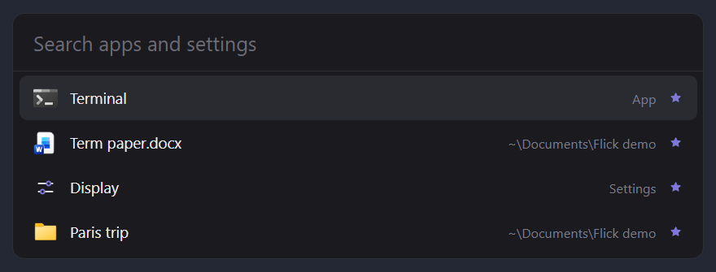

# Typing and keys

Everything you can type in the bar, the keys it understands, and how results are ordered.

[Back to the overview](../README.md)

## What you can type

| You type | What happens | Example |
|---|---|---|
| Part of an app name | Opens the app (Start-menu shortcuts and Store apps). An app you just installed shows up within seconds, a Store app the next time you open the bar | `vsc` opens Visual Studio Code |
| Part of a file or folder name | Opens it (searches your whole user folder by default) | `invoice` |
| A folder path (a drive, `~`, or a network share) | Lists that folder's contents; Enter opens an item | `C:\`, `~\Documents\` |
| `dl` | The 20 newest files in your Downloads folder | `dl` |
| `recent` | Files and folders you opened recently, from Windows' own Recent list | `recent` |
| `v`, then text to filter | Your clipboard history (Win+V); Enter pastes the item | `v`, `v invoice` |
| `qr`, or `qr` and some text | Shows the clipboard text, or the typed text, as a QR code | `qr`, `qr some text` |
| `password`, or `password` and a length | Makes a random password (20 characters, or 8 to 64); Enter copies it | `password`, `password 32` |
| `uuid` | Makes a random UUID; Enter copies it | `uuid` |
| `lorem`, or `lorem` and a number | Filler text, 1 to 10 paragraphs; Enter copies it | `lorem`, `lorem 3` |
| `hash` | The SHA-256 of the clipboard text; Enter copies it | `hash` |
| `snip` (also `screenshot`) | Opens Windows' snip tool | `snip` |
| `color` (also `colour`, `picker`) | Picks a colour on screen and copies it as `#RRGGBB` | `color` |
| A Settings page | Opens that Windows Settings page | `bluetooth`, `installed apps` |
| A power action | Lock, sleep, restart, shut down or sign out | `lock` |
| Part of a game's name | Starts the game through its launcher (Steam, Epic, Rockstar, Minecraft) | `hades` |
| Part of a bookmark's title or site | Opens the Firefox bookmark in your browser | `example` |
| A workspace's name | Opens every item of the workspace, in order | `work` |
| A snippet's name | Pastes the snippet's text into the window you were in; Ctrl+Enter only copies it. `snippets` lists them all | `sig` |
| `timer` and a time | A timer that rings with a Windows notification | `timer 5m` |
| `remind`, a time and a note | A reminder after a while, at a time today, or tomorrow | `remind 20m pizza`, `remind 18:30 call mum`, `remind tomorrow 9:00 dentist` |
| `timers` | Your pending timers and reminders; Enter twice cancels one | `timers` |
| `tr` and some text | Translates between two languages, German and English unless you pick others (online) | `tr guten Morgen`, `tr >fr good morning` |
| `def` and a word | Definitions from Wiktionary (online) | `def serendipity` |
| `connect` or `disconnect`, and a device | Connects or disconnects a paired Bluetooth audio device | `connect headphones` |
| `wifi` and a network | Joins a saved Wi-Fi network | `wifi home` |
| `empty bin` | Empties the Recycle Bin (press Enter twice) | `empty bin` |
| `eject`, or `eject` and a drive | Safely removes a USB drive | `eject`, `eject E:` |
| `flush dns` | Clears Windows' DNS cache | `flush dns` |
| `restart explorer` | Restarts the taskbar and desktop (press Enter twice) | `restart explorer` |
| A sum, a unit or currency conversion, a time or date, or `weather` | Shows the answer on top; Enter copies it (on a weather answer, Enter opens a web search) | `12*7`, `20 usd in eur`, `time tokyo` (see [Quick answers](answers.md)) |
| `?`, `g`, `yt` or `gh`, then your search | Searches the web in your browser | `? rust lifetimes` |
| The name of one of your shortcuts | Runs it | `search rust traits` (after adding the `search` shortcut from [Shortcuts](shortcuts.md)) |
| `>` and a command | Runs the command in WSL | `> htop -d 10` |
| `clear history` | Forgets recent searches and launches (press Enter twice) | `clear history` |
| `help`, or press F1 | Lists everything Flick can do | `help file` |
| `settings` | Opens the Settings window | `settings` |
| `flick config` | Opens the config file | `flick config` |

If you press Enter while results for what you just typed are still on their way, Flick waits for them and opens the new top result.

## Keys

| Key | Action |
|---|---|
| Alt+Space | Open the bar (configurable) |
| Enter | Open the selected result |
| Ctrl+Enter | Show the selected file or folder in Explorer |
| Ctrl+Shift+Enter | Run the selected app as administrator |
| Enter again | Confirm restart, shut down or sign out |
| Up / Down | Move the selection |
| Right / Left | With the cursor at the end of the text: unfold or fold the selected folder (see [Unfolding a folder](files.md#unfolding-a-folder)) |
| Tab | Open the actions menu of the selected row; while a path is typed, complete the selected name |
| Mouse wheel | Scroll the list |
| Up (empty bar) | Recall your past searches, newest first |
| Ctrl+P | Pin or unpin the selected row |
| F1 | Show the help list |
| Esc | Leave a shortcut's list; otherwise close the bar |

On an empty bar, Enter opens the most recent launch again.

The hotkey does nothing while an exclusive full-screen app (such as a game) is in front. Nothing pops up over the game; afterwards the tray icon's tooltip and the first line of its menu say that the last press was ignored, until the bar next opens. A game that is minimised or behind another window doesn't block it.

Ctrl+Shift+Enter works for apps only, both Start-menu shortcuts and Store apps. Your own shortcuts with `admin = true` always run as administrator. A Store app that cannot be elevated says "this app cannot be run as administrator" instead of opening normally. Cancelling the UAC prompt just closes the bar.

## Icons and the mouse

Each result shows the icon of its app, file or folder. Icons load in the background, so the text always appears first.

- Moving the mouse over a row selects it.
- A click opens it.
- A right click (or Tab) opens a menu of the row's own actions: Open file location, Open in Explorer, Copy path, Run as administrator, Uninstall (asks for a second Enter), Close, Close window, Pin or Unpin. Entries that do not apply to that row are left out.

## Tab completion

Switch on **Tab completion** in Settings, General (or set `tab_completion = true`), and the bar finishes names for you:

- As you type, the rest of the top result's name appears in grey: `fir` shows the grey `efox`. Press Tab to take it.
- It appears only when the top result's name starts with what you typed.
- No row is highlighted until you press Down (or move the mouse over a row). Enter still opens the top result.
- Once a row is highlighted, Tab opens that row's menu, as without the setting.

It is off by default.
## Pins and recent launches

Pin the things you open every day. Select a row and press Ctrl+P (again to unpin), or use the right-click menu. With an empty bar, Flick shows your pins first, each with a star, and under them your last 5 launches. Pins stay until you unpin them.

## Past searches

Past searches are off on a new install; switch on "Remember past searches and launches" in Settings, General, to use them. With that on, a search is saved when you open a result from it. Press Up on an empty bar to step back through those searches (the last 50). Press Down to step forward again. Typing anything stops the recall.

Type `clear history` and press Enter twice to forget past searches and recent launches. Pins are kept.

To stop all of this, add `history = false` to the config. Flick then records nothing and deletes `history.json`. Pins are not affected.

What is never saved as a past search

- Text after `>` (WSL commands).
- Text you type into a shortcut, or into one of its lists.
- `help`.

Power actions (lock, sleep, restart and so on) are never saved as recent launches either.

## Help

Type `help` (in any case) to see one line for each kind of result, with an example. Type more after it to filter the list (`help file`). Picking a line puts its example in the bar, so `> htop -d 10` gives you `> ` ready to type. F1 does the same as typing `help`, and leaves a shortcut's list first.
